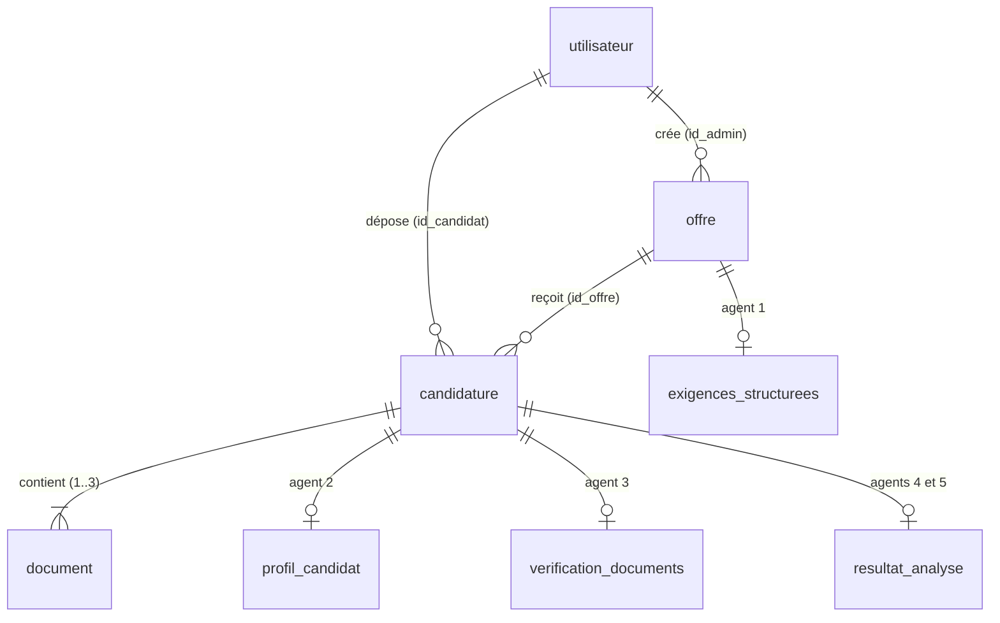

# Documentation de la base de données

**Responsable : Abderrahmane** · PostgreSQL 17 · SQLAlchemy 2 · Alembic

La base est la traduction **exacte** du diagramme de classes UML v2 (`database/schema/diagramme_classes.jpg`) : une table par
classe, nommée comme la classe en `snake_case`, avec exactement ses attributs. Les classes `«JSON»` du diagramme (Langue, Formation,
Experience, InfosDiplome, InfosCIN, RapportCandidature, DetailCritere, Incoherence) ne sont pas des tables : elles sont stockées en
**JSONB** dans la colonne qui les porte. Seule différence avec le diagramme : `ResultatAnalyse.details_score` s'appelle **`details`**.

## 1. Où se trouve le code

| Élément | Fichier |
|---|---|
| Énumérations | `app/models/enums.py` |
| Tables `utilisateur` | `app/models/utilisateur.py` |
| Tables `offre`, `candidature`, `document` | `app/models/recrutement.py` |
| Tables des agents (4) | `app/models/resultats_agents.py` |
| Connexion / session | `app/db/session.py`, `app/db/base.py` (URL : `DATABASE_URL` dans `.env`) |
| Création des tables (SQL) | `database/migrations/versions/0002_schema_uml.py` (`alembic.ini` à la racine) |
| SQL lisible de tout le schéma | `database/schema/schema.sql` (généré : `python -m database.schema.generer_sql`) |
| Données de départ | `database/seed/seed.py` |
| Enregistrement des résultats des agents | `app/services/enregistrement_resultats.py` |
| Tests de conformité au diagramme | `backend/tests/test_uml_schema.py` |

## 2. Relations



## 3. Les 8 tables

Types : `JSONB` = liste ou objet JSON. Les contrats JSON sont dans `agents/common/schemas.py`.

### 3.1 `utilisateur` : comptes
**Rôle :** identifier qui se connecte. L'administrateur crée les offres ; le candidat dépose ses candidatures.

| Attribut | Type | Description |
|---|---|---|
| `id` | entier, PK | Identifiant |
| `nom`, `prenom` | texte | Nom, prénom |
| `email` | texte, **unique** | Identifiant de connexion |
| `mot_de_passe_hash` | texte | Mot de passe haché (bcrypt), jamais en clair |
| `role` | enum `RoleUtilisateur` | `ADMIN`, `CANDIDAT` |
| `telephone` | texte, optionnel | Téléphone |

### 3.2 `offre` : offres d'emploi
**Rôle :** décrire un poste. Cycle de vie : `BROUILLON` → `PUBLIEE` → `CLOTUREE` ; seul un brouillon est modifiable ou supprimable.

| Attribut | Type | Description |
|---|---|---|
| `id` | entier, PK | Identifiant |
| `id_admin` | FK → `utilisateur.id` | Administrateur auteur |
| `titre`, `description` | texte | Intitulé et description |
| `diplome_demande` | texte, optionnel | Diplôme exigé |
| `experience_annees` | réel, optionnel | Expérience demandée |
| `competences_obligatoires`, `competences_souhaitees`, `langues` | JSONB (liste de texte) | Exigences saisies |
| `localisation` | texte, optionnel | Lieu |
| `statut` | enum `StatutOffre` | `BROUILLON`, `PUBLIEE`, `CLOTUREE` |
| `date_creation`, `date_publication`, `date_cloture` | date-heure | Cycle de vie |

### 3.3 `candidature` : candidatures
**Rôle :** relier un candidat à une offre et suivre le traitement. C'est le **point central** : documents et résultats s'y rattachent. Un candidat ne postule qu'une fois à la même offre.

| Attribut | Type | Description |
|---|---|---|
| `id` | entier, PK | Identifiant |
| `id_candidat` | FK → `utilisateur.id` | Candidat |
| `id_offre` | FK → `offre.id` | Offre visée |
| `date_candidature` | date-heure | Date de dépôt |
| `statut` | enum `StatutCandidature` | `ENVOYEE`, `EN_ATTENTE_DE_TRAITEMENT`, `EN_COURS_DE_TRAITEMENT`, `ANALYSE_TERMINEE`, `ERREUR_DE_TRAITEMENT` |
| `message_erreur` | texte, optionnel | Cause de l'échec du traitement |

### 3.4 `document` : fichiers déposés
**Rôle :** référencer les pièces du candidat (1 à 3 : au plus un CV, un diplôme, une CIN). Seul le chemin est en base ; le fichier est dans `storage/uploads/`.

| Attribut | Type | Description |
|---|---|---|
| `id` | entier, PK | Identifiant |
| `id_candidature` | FK → `candidature.id` | Candidature |
| `type` | enum `TypeDocument` | `CV`, `DIPLOME`, `CIN` |
| `chemin_fichier` | texte | Emplacement sur le disque |
| `date_import` | date-heure | Date de dépôt |

### 3.5 `exigences_structurees` : résultat de l'agent 1
**Rôle :** version structurée de l'offre, utilisée ensuite pour comparer les candidats. 0..1 par offre.

| Attribut | Type | Description |
|---|---|---|
| `id_offre` | PK et FK → `offre.id` | Offre analysée |
| `titre_poste` | texte | Titre du poste |
| `diplome_demande` | texte | Diplôme exigé |
| `niveau_diplome_min` | entier (0..8) | Niveau minimal en « Bac+N » |
| `experience_min_annees` | réel | Expérience minimale |
| `competences_obligatoires`, `competences_souhaitees` | JSONB (liste de texte) | Compétences |
| `langues` | JSONB (liste de `Langue`) | `{langue, niveau}` |
| `missions` | JSONB (liste de texte) | Missions principales |

### 3.6 `profil_candidat` : résultat de l'agent 2
**Rôle :** informations extraites du CV. 0..1 par candidature.

| Attribut | Type | Description |
|---|---|---|
| `id_candidature` | PK et FK → `candidature.id` | Candidature |
| `nom`, `prenom`, `email`, `telephone` | texte | Identité lue dans le CV |
| `formations` | JSONB (liste de `Formation`) | diplôme, spécialité, établissement, dates |
| `experiences` | JSONB (liste de `Experience`) | poste, entreprise, description, dates, durée, compétences |
| `competences`, `certifications` | JSONB (liste de texte) | Compétences, certifications |
| `langues` | JSONB (liste de `Langue`) | Langues |
| `experience_totale_annees` | réel | Expérience totale |

### 3.7 `verification_documents` : résultat de l'agent 3
**Rôle :** contrôle du diplôme et de la CIN (OCR) et de leur cohérence avec le CV. 0..1 par candidature.

| Attribut | Type | Description |
|---|---|---|
| `id_candidature` | PK et FK → `candidature.id` | Candidature |
| `infos_diplome` | JSONB (`InfosDiplome`), optionnel | Données lues sur le diplôme |
| `infos_cin` | JSONB (`InfosCIN`), optionnel | Données lues sur la CIN ; **numéro masqué** à l'enregistrement |
| `documents_analyses`, `documents_manquants`, `documents_illisibles` | JSONB (liste de texte) | État des pièces |
| `incoherences` | JSONB (liste de `Incoherence`) | type, description, gravité, documents |
| `niveau_conformite` | enum `NiveauConformite` | `CONFORME`, `PARTIELLEMENT_CONFORME`, `NON_CONFORME` |
| `score_coherence` | entier (0..100) | Score de cohérence |
| `resume` | texte | Résumé |

### 3.8 `resultat_analyse` : résultat des agents 4 et 5
**Rôle :** ce que consulte le recruteur : score de correspondance (agent 4) et rapport de synthèse (agent 5). Le score est une aide à la décision. 0..1 par candidature.

| Attribut | Type | Description |
|---|---|---|
| `id_candidature` | PK et FK → `candidature.id` | Candidature |
| `score_global` | réel (0..100) | Score global |
| `details` | JSONB (liste de 6 `DetailCritere`) | critère, pondération, score, justification |
| `competences_correspondantes`, `competences_manquantes` | JSONB (liste de texte) | Comparaison avec l'offre |
| `diplome_conforme` | booléen | Diplôme conforme |
| `experience_candidat_annees` | réel | Expérience du candidat |
| `rapport` | JSONB (`RapportCandidature`), optionnel | Rapport de l'agent 5 (peut arriver après) |
| `avis_indicatif` | enum `AvisIndicatif`, optionnel | `FAVORABLE`, `DEFAVORABLE`, `A_ETUDIER` |
| `date_analyse` | date-heure | Date de l'analyse |

Les 6 critères (`Critere`) : `COMPETENCES_OBLIGATOIRES`, `EXPERIENCE`, `DIPLOME_FORMATION`, `COMPETENCES_SOUHAITEES`, `LANGUES`, `COHERENCE_DOCUMENTS`.

## 4. Règles d'intégrité

- **Cascade :** supprimer une offre supprime ses candidatures, exigences, puis leurs documents et résultats.
- **Auteur protégé :** un administrateur qui a créé une offre ne peut pas être supprimé (`RESTRICT`).
- **Un résultat par offre / candidature :** la clé primaire est la clé étrangère ; relancer une analyse remplace la ligne.
- **Contraintes ajoutées au diagramme :** `(id_candidat, id_offre)` unique dans `candidature` ; `(id_candidature, type)` unique dans `document` (garantit « au plus 3 »).
- **Énumérations :** stockées en types ENUM PostgreSQL, avec exactement les valeurs du diagramme.

## 5. Enregistrer les résultats des agents (tâche « 4 tables »)

```python
from app.services import (enregistrer_exigences_structurees, enregistrer_resultats_candidature,
                          enregistrer_erreur_traitement)

enregistrer_exigences_structurees(db, id_offre, sortie_agent1)              # exigences_structurees
enregistrer_resultats_candidature(db, id_candidature, profil=a2, verification=a3,
                                  matching=a4, rapport=a5)                  # profil_candidat, verification_documents,
                                                                            # resultat_analyse + statut ANALYSE_TERMINEE
enregistrer_erreur_traitement(db, id_candidature, "Ollama indisponible")    # statut ERREUR_DE_TRAITEMENT
```

Chaque sortie est validée avec `agents/common/schemas.py` avant écriture (dict brut ou objet Pydantic acceptés).
Les 3 tables d'une candidature sont écrites en une transaction : tout ou rien.

## 6. Créer et utiliser la base

```bash
cp .env.example .env              # choisir POSTGRES_PASSWORD
docker compose up --build         # `migrate` lance : alembic upgrade head
docker compose run --rm seed      # admin, candidat et offre de test
python -m pytest backend/tests    # tests (SQLite en mémoire ; TEST_DATABASE_URL=... pour PostgreSQL)
```

Hors Docker : `alembic upgrade head` avec `DATABASE_URL` dans `.env`. Les tables sont créées **uniquement par Alembic**.
Aucune donnée réelle n'est stockée : toutes les données du projet sont fictives.
