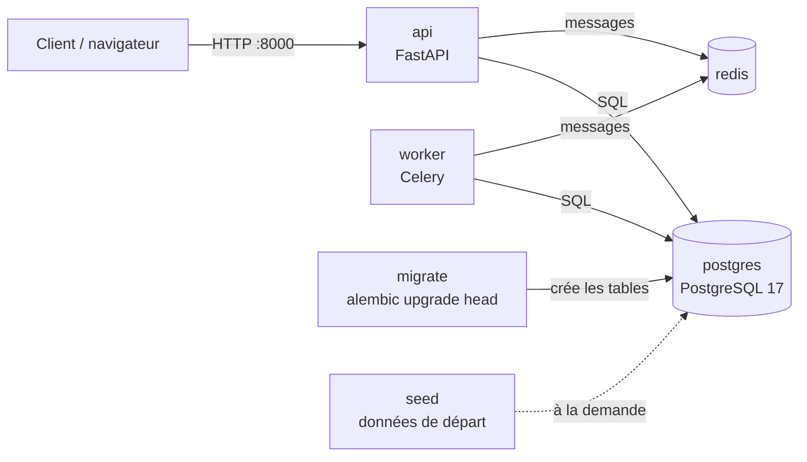
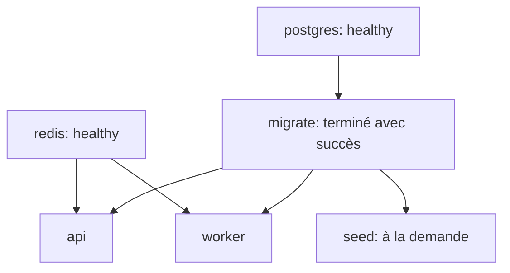
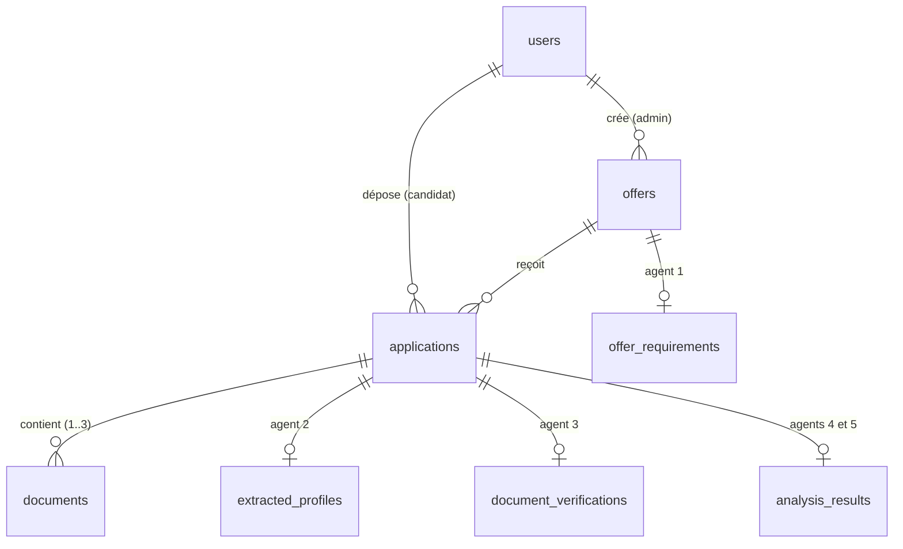
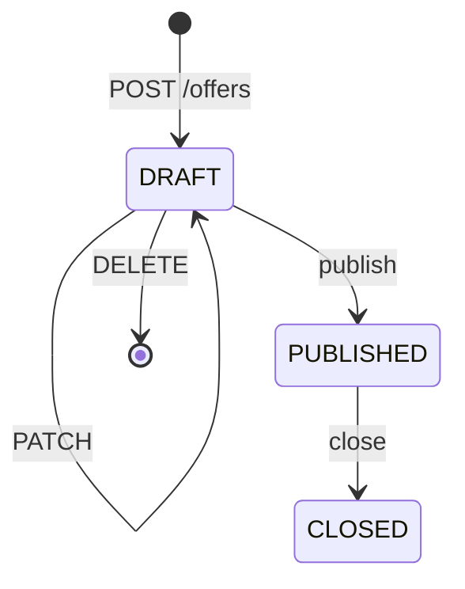

# Documentation technique : dépôt, Docker et Docker Compose

Plateforme de recrutement par agents d'IA (Agentic AI). Ce document explique comment le dépôt est organisé, comment lancer
la pile (PostgreSQL, Redis, API, worker) avec Docker Compose, comment fonctionne la base de données et l'API des offres,
et comment résoudre les problèmes courants.

## Sommaire
1. [Vue d'ensemble](#1-vue-densemble)
2. [Structure du dépôt](#2-structure-du-dépôt)
3. [Démarrage rapide](#3-démarrage-rapide)
4. [Configuration (`.env`)](#4-configuration-env)
5. [Docker et Docker Compose](#5-docker-et-docker-compose)
6. [Base de données PostgreSQL](#6-base-de-données-postgresql)
7. [API : CRUD des offres](#7-api--crud-des-offres)
8. [Tests et intégration continue](#8-tests-et-intégration-continue)
9. [Travailler sans Docker](#9-travailler-sans-docker)
10. [Problèmes courants](#10-problèmes-courants)
11. [Règles d'équipe](#11-règles-déquipe)

---

## 1. Vue d'ensemble



| Brique | Technologie | Rôle |
|---|---|---|
| API | FastAPI, Pydantic | Routes HTTP, validation |
| Base de données | PostgreSQL 17, SQLAlchemy 2, Alembic | Données applicatives, résultats des agents en JSONB |
| Traitement asynchrone | Celery + Redis | Orchestrateur des 5 agents (à venir) |
| Agents | Python, Ollama, Tesseract | Analyse de l'offre, du CV, des documents, score, rapport |
| Conteneurs | Docker Compose | Lance toute la pile avec une commande |

> Les agents d'IA (Ollama, OCR) ne tournent **pas** dans Docker pour l'instant : ils sont testés avec des faux modèles.

## 2. Structure du dépôt

```text
agentic-ai-recruitment/
├── agents/                 5 agents d'IA ; contrats dans agents/common/schemas.py
├── backend/
│   ├── app/                API FastAPI
│   │   ├── main.py             point d'entrée, erreurs, /health
│   │   ├── api/routes/         une route par ressource (offers.py)
│   │   ├── api/dependencies/   dépendances FastAPI (db.py : session SQL)
│   │   ├── core/               config.py, security.py, exceptions.py
│   │   ├── db/                 base.py (Base), session.py (engine, SessionLocal)
│   │   ├── models/             tables : user.py, offer.py, application.py
│   │   ├── schemas/            formats d'entrée/sortie de l'API
│   │   ├── services/           règles métier (offers.py)
│   │   └── celery_app.py       application Celery
│   ├── orchestrateur/          enchaînement des agents (à venir)
│   ├── tests/                  tests du backend (PostgreSQL réel)
│   └── requirements.txt
├── database/
│   ├── schema/                 mcd_merise.jpg, diagramme_classes.jpg, schema.sql
│   ├── migrations/             Alembic : env.py, versions/
│   └── seed/                   seed.py
├── docker/backend.Dockerfile   image de l'API, du worker, de migrate et de seed
├── docker-compose.yml          la pile complète
├── alembic.ini                 configuration Alembic (l'URL vient de DATABASE_URL)
├── .env.example                modèle de configuration (copier en .env)
├── pytest.ini                  chemins d'import et de tests
├── requirements.txt            backend + agents
├── data/  docs/  frontend/  scripts/  tests/
└── .github/workflows/tests.yml intégration continue
```

Principe : **un seul endroit par chose**. Le contrat des agents est `agents/common/schemas.py` (aucune copie ailleurs) et les
tables sont créées **uniquement** par Alembic.

Les imports se font depuis la racine : `from agents.common.schemas import ...` et `from app.main import app`
(`pytest.ini` et le `PYTHONPATH` du Dockerfile ajoutent la racine et `backend/`).

## 3. Démarrage rapide

Prérequis : Docker et Docker Compose v2 (`docker compose version`).

```bash
git clone <URL-DU-DEPOT> && cd <NOM-DU-DEPOT>
cp .env.example .env                 # Windows : copy .env.example .env
# ouvrir .env et choisir POSTGRES_PASSWORD (voir §4)
docker compose up --build            # premier démarrage : télécharge et construit les images
docker compose run --rm seed         # dans un autre terminal : admin, candidat, offre de test
```

Vérifier :

| Quoi | Où |
|---|---|
| Documentation interactive de l'API (Swagger) | <http://localhost:8000/docs> |
| API vivante | <http://localhost:8000/health> → `{"status":"ok"}` |
| API + base de données | <http://localhost:8000/health/db> → `{"status":"ok"}` |
| Offres | <http://localhost:8000/offers> |

Arrêter : `Ctrl+C`, ou `docker compose down` (les données restent).

## 4. Configuration (`.env`)

`.env` n'est **jamais** envoyé sur Git (déjà dans `.gitignore`). Il est lu par Docker Compose (substitution des `${...}`
et variables des conteneurs) et par l'application quand elle tourne hors Docker.

| Variable | Défaut | Rôle |
|---|---|---|
| `POSTGRES_PASSWORD` | **obligatoire** | Mot de passe de la base. Évite les caractères `@ : / # %`, qui casseraient l'URL |
| `POSTGRES_USER` | `recruitment_user` | Utilisateur PostgreSQL |
| `POSTGRES_DB` | `recruitment_db` | Nom de la base |
| `POSTGRES_PORT` | `5432` | Port exposé sur ta machine |
| `API_PORT` | `8000` | Port exposé de l'API |
| `REDIS_PORT` | `6379` | Port exposé de Redis |
| `DATABASE_URL` | voir `.env.example` | URL utilisée **hors Docker** (hôte `localhost`). Dans Docker, `docker-compose.yml` la remplace par une URL avec l'hôte `postgres` |
| `SEED_ADMIN_EMAIL` / `SEED_ADMIN_PASSWORD` | `admin@example.com` / valeur d'exemple | Compte administrateur de développement |
| `SEED_CANDIDATE_EMAIL` / `SEED_CANDIDATE_PASSWORD` | `candidate@example.com` / valeur d'exemple | Compte candidat de développement |
| `JWT_SECRET` | vide | Secret des jetons (authentification, Fatima) |
| `UPLOAD_DIR` | `storage/uploads` | Dossier des documents déposés |
| `OLLAMA_*`, `TESSERACT_*` | voir `.env.example` | Agents d'IA et OCR |
| `MAILTRAP_*`, `ADMIN_EMAIL` | vide | Emails de test (Amina) |

Les variables `REDIS_URL`, `CELERY_BROKER_URL` et `CELERY_RESULT_BACKEND` sont fixées par `docker-compose.yml`
(hôte `redis`) ; hors Docker, les valeurs par défaut pointent vers `localhost`.

## 5. Docker et Docker Compose

### 5.1 L'image `docker/backend.Dockerfile`

Une seule image sert quatre services (`api`, `worker`, `migrate`, `seed`). Elle part de `python:3.12-slim`,
installe `requirements.txt` (backend + agents) dans une couche mise en cache, copie le dépôt dans `/app`
et définit `PYTHONPATH=/app:/app/backend`. Contexte de build : **la racine du dépôt**.

```bash
docker build -f docker/backend.Dockerfile -t recruitment-backend .
```

### 5.2 Les services de `docker-compose.yml`

| Service | Image | Rôle | Port | Redémarrage |
|---|---|---|---|---|
| `postgres` | `postgres:17-alpine` | Base de données | 5432 | automatique |
| `redis` | `redis:7-alpine` | Broker Celery (persistance activée) | 6379 | automatique |
| `migrate` | image du backend | Lance `alembic upgrade head` **une fois**, puis s'arrête | n/a | jamais |
| `api` | image du backend | `uvicorn app.main:app --reload` | 8000 | automatique |
| `worker` | image du backend | `celery -A app.celery_app:celery_app worker` | n/a | automatique |
| `seed` | image du backend | `python -m database.seed.seed` (profil `seed`, lancé à la main) | n/a | jamais |

### 5.3 Ordre de démarrage



`docker compose up` attend que PostgreSQL réponde (`pg_isready`), applique les migrations, puis démarre l'API et le worker.
Si `migrate` échoue, ni l'API ni le worker ne démarrent : lire `docker compose logs migrate`.

### 5.4 Volumes

| Volume | Contenu | Supprimé par `down -v` |
|---|---|---|
| `postgres_data` | Fichiers de PostgreSQL | oui |
| `redis_data` | Journal AOF de Redis | oui |
| `uploads_data` | Documents déposés (`/app/storage/uploads`) | oui |

En plus, le dépôt est monté dans `/app` (`.:/app`) : **mode développement**, le code modifié est pris en compte sans reconstruire
(`--reload` redémarre l'API).

### 5.5 Contrôles de santé

- `postgres` : `pg_isready` toutes les 5 s.
- `redis` : `redis-cli ping` toutes les 5 s.
- `api` : appelle `/health/db` toutes les 10 s (état « healthy » seulement si la base répond).

### 5.6 Commandes utiles

```bash
docker compose up --build -d                  # démarre en arrière-plan
docker compose ps                             # état des services
docker compose logs -f api                    # journaux d'un service (api, worker, migrate, postgres)
docker compose run --rm seed                  # données de départ (idempotent)
docker compose run --rm migrate               # rejouer les migrations
docker compose run --rm api alembic revision --autogenerate -m "description"   # nouvelle migration
docker compose exec postgres psql -U recruitment_user -d recruitment_db        # console SQL
docker compose exec api python -m pytest backend -q                            # tests dans le conteneur
docker compose restart api                    # redémarrer un service
docker compose down                           # arrêter, garder les données
docker compose down -v                        # arrêter ET effacer base, Redis et uploads
```

### 5.7 Passer en production (à faire avant un vrai déploiement)

Le fichier est conçu pour le **développement**. Pour la production : retirer le montage `.:/app` et l'option `--reload`,
ne plus publier les ports 5432 et 6379, utiliser un vrai `POSTGRES_PASSWORD` et un `JWT_SECRET` secrets, ajouter un serveur
frontal HTTPS, et ne pas lancer `seed` avec les mots de passe d'exemple.

## 6. Base de données PostgreSQL

Le schéma suit le MCD et le diagramme de classes figés (`database/schema/mcd_merise.jpg`, `diagramme_classes.jpg`).
Les colonnes sont en anglais dans le code ; les diagrammes sont en français (même sens).



| Table | Contenu | Points importants |
|---|---|---|
| `users` | Comptes | `email` unique ; rôle `ADMIN` ou `CANDIDATE` ; mot de passe haché (bcrypt) |
| `offers` | Offres d'emploi | Statut `DRAFT` → `PUBLISHED` → `CLOSED` ; compétences en JSONB ; `creator_id` protégé (`RESTRICT`) |
| `applications` | Candidatures | Unique `(candidate_id, offer_id)` ; statuts `SUBMITTED`, `PENDING_PROCESSING`, `PROCESSING`, `ANALYSIS_COMPLETED`, `PROCESSING_ERROR` |
| `documents` | CV, diplôme, CIN | Unique `(application_id, document_type)` ; suppression en cascade |
| `offer_requirements` | Sortie de l'agent 1 | Une ligne par offre (JSONB) |
| `extracted_profiles` | Sortie de l'agent 2 | Une ligne par candidature (JSONB) |
| `document_verifications` | Sortie de l'agent 3 | `cin_info` est sensible : jamais dans les logs ni transmis aux agents 4 et 5 |
| `analysis_results` | Sortie des agents 4 et 5 | Score, détail des 6 critères, rapport |

Supprimer une offre supprime ses candidatures, puis leurs documents et résultats (`ON DELETE CASCADE`).

### Migrations (Alembic)

Le schéma est créé **uniquement** par les migrations de `database/migrations/versions/`.

```bash
alembic upgrade head                               # appliquer
alembic downgrade -1                               # annuler la dernière
alembic check                                      # modèles et migrations sont-ils d'accord ?
alembic revision --autogenerate -m "ajoute X"      # après avoir modifié un modèle
```

Workflow pour modifier une table : 1) modifier le modèle dans `backend/app/models/`, 2) générer la migration,
3) **relire** le fichier généré (types, valeurs par défaut, enums), 4) `alembic upgrade head`, 5) `alembic check`,
6) committer modèle et migration ensemble. Ne jamais modifier une migration déjà fusionnée dans `main` ; en créer une nouvelle.
N'utilise pas `Base.metadata.create_all()` : il créerait des tables en dehors d'Alembic.

### Données de départ (seed)

`docker compose run --rm seed` (ou `python -m database.seed.seed`) crée un administrateur, un candidat et une offre publiée
de test. Le script est **idempotent** : le relancer ne crée aucun doublon et ne modifie rien. Il exige que les tables existent déjà.

## 7. API : CRUD des offres

Documentation interactive et à jour : <http://localhost:8000/docs>.

| Méthode | Route | Effet | Succès | Erreurs |
|---|---|---|---|---|
| POST | `/offers` | Crée une offre **brouillon** | 201 | 403 si le créateur n'est pas admin, 404 créateur inconnu, 422 données invalides |
| GET | `/offers` | Liste (récentes d'abord). Paramètres : `status`, `limit` (1 à 200, défaut 50), `offset` | 200 | 422 |
| GET | `/offers/{id}` | Détail | 200 | 404 |
| PATCH | `/offers/{id}` | Modifie les champs envoyés | 200 | 404, 409 si l'offre n'est pas un brouillon, 422 |
| POST | `/offers/{id}/publish` | Brouillon → publiée | 200 | 404, 409 |
| POST | `/offers/{id}/close` | Publiée → clôturée | 200 | 404, 409 |
| DELETE | `/offers/{id}` | Supprime un brouillon | 204 | 404, 409 si l'offre n'est pas un brouillon |
| GET | `/health`, `/health/db` | Vivacité ; vivacité + base de données (503 si PostgreSQL ne répond pas) | 200 | 503 |



Exemple complet (`creator_id` = identifiant de l'administrateur créé par le seed, normalement `1`) :

```bash
# créer
curl -X POST http://localhost:8000/offers -H 'Content-Type: application/json' -d '{
  "creator_id": 1, "title": "Data Scientist", "description": "Modèles de ML",
  "diploma_required": "Master", "experience_years": 1.5,
  "required_skills": ["Python", "SQL"], "desired_skills": ["Docker"],
  "languages": ["Français"], "location": "Agadir"}'

# modifier, publier, clôturer
curl -X PATCH http://localhost:8000/offers/2 -H 'Content-Type: application/json' -d '{"location": "Casablanca"}'
curl -X POST  http://localhost:8000/offers/2/publish
curl -X POST  http://localhost:8000/offers/2/close

# lister les offres publiées
curl 'http://localhost:8000/offers?status=published&limit=10'
```

Règles de validation : `title` et `description` non vides ; `experience_years` ≥ 0 ; les listes de compétences sont nettoyées
(espaces retirés, vides et doublons supprimés) ; les champs inconnus, comme `status`, sont refusés (422) ;
dans un PATCH, `title`, `description` et les listes ne peuvent pas être `null`.

Organisation du code : la route (`api/routes/offers.py`) ne fait que la couche HTTP ; les règles métier sont dans
`services/offers.py`, qui lève `NotFoundError` (404), `ConflictError` (409) ou `ForbiddenError` (403), traduites par `main.py`.

> **Limite actuelle** : l'authentification JWT n'existe pas encore. `creator_id` est envoyé dans le corps de la requête et
> les routes ne sont pas protégées. Avec le JWT (Fatima), il viendra du jeton et l'écriture sera réservée à l'administrateur.

## 8. Tests et intégration continue

```bash
python -m pytest backend -q                    # backend : CRUD, schéma de la base, migrations
python -m pytest agents/tests -q               # mocks et contrats des agents
python -m pytest -q                            # tout
```

- Les tests du backend utilisent un **vrai PostgreSQL** (JSONB, enums), jamais SQLite. La base `recruitment_test` est créée
  automatiquement, reconstruite avec Alembic (la migration est donc testée), puis vidée avant chaque test.
- URL : variable `TEST_DATABASE_URL` (défaut : `localhost:5432` avec les identifiants de `.env.example`). Le nom de la base doit
  finir par `_test` : la base de développement ne peut pas être effacée par erreur.
- Sans PostgreSQL joignable, les tests du backend sont **ignorés** (pas en échec). Pour en avoir un : `docker compose up -d postgres`.
- GitHub Actions (`.github/workflows/tests.yml`) : à chaque push sur `main` et chaque pull request, avec un service PostgreSQL ;
  Python 3.12 ; lance les tests des mocks puis ceux du backend.
- Trois tests de `agents/common/test_llm_local.py` échouent déjà (modèles par défaut des agents) : ils concernent les agents,
  pas le backend.

## 9. Travailler sans Docker

PostgreSQL doit tourner (par exemple `docker compose up -d postgres`) et `DATABASE_URL` doit pointer vers `localhost`.

```bash
python -m venv .venv && source .venv/bin/activate     # Windows : .venv\Scripts\Activate.ps1
python -m pip install -r requirements.txt
cp .env.example .env
alembic upgrade head
python -m database.seed.seed
uvicorn app.main:app --app-dir backend --reload
```

## 10. Problèmes courants

| Symptôme | Cause | Solution |
|---|---|---|
| `required variable POSTGRES_PASSWORD is missing` | Pas de fichier `.env` | `cp .env.example .env` |
| `password authentication failed` après avoir changé le mot de passe | PostgreSQL garde le mot de passe de la **première** création du volume | `docker compose down -v` puis `up` (efface la base) |
| `port is already allocated` (5432, 6379 ou 8000) | Un autre programme utilise le port | Changer `POSTGRES_PORT`, `REDIS_PORT` ou `API_PORT` dans `.env` |
| L'API ne démarre pas, `migrate` en erreur | Migration en échec | `docker compose logs migrate` |
| `relation "users" does not exist` | Migrations non appliquées (hors Docker) | `alembic upgrade head` |
| `The tables do not exist yet` au seed | Même cause | `alembic upgrade head` puis relancer le seed |
| `connection refused` / `could not translate host name "postgres"` hors Docker | `DATABASE_URL` pointe vers l'hôte `postgres` | Utiliser `localhost` hors Docker |
| `alembic check` signale des différences | Modèle modifié sans migration | `alembic revision --autogenerate` |
| Tests du backend ignorés | PostgreSQL injoignable | `docker compose up -d postgres` |
| Modifications du code non vues | Image utilisée sans le montage `.:/app` | Reconstruire : `docker compose up --build` |
| Réinitialiser complètement | n/a | `docker compose down -v && docker compose up --build` |

## 11. Règles d'équipe

- Aucun mot de passe, aucune clé dans Git : tout passe par `.env`. Données fictives uniquement.
- Une pull request par tâche, revue par le responsable du dossier touché (voir `TEAM_RESPONSIBILITIES.md`).
- `agents/common/schemas.py` et `data/mocks/` sont des contrats : modification seulement après accord de la cheffe de projet.
- Le numéro de CIN est sensible : masqué dans les logs, retiré avant les agents 4 et 5.
- Aucune analyse IA sans action explicite de l'administrateur.
